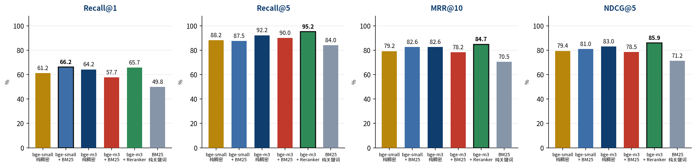
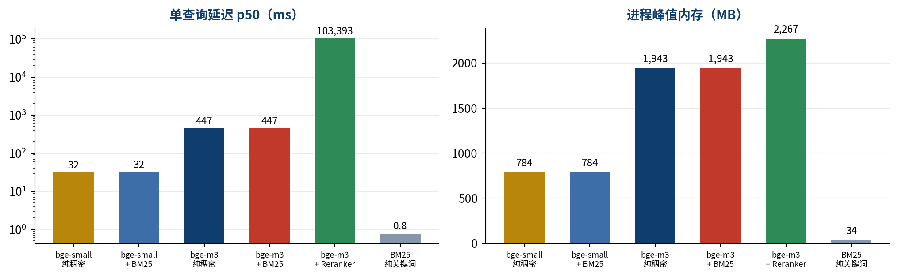
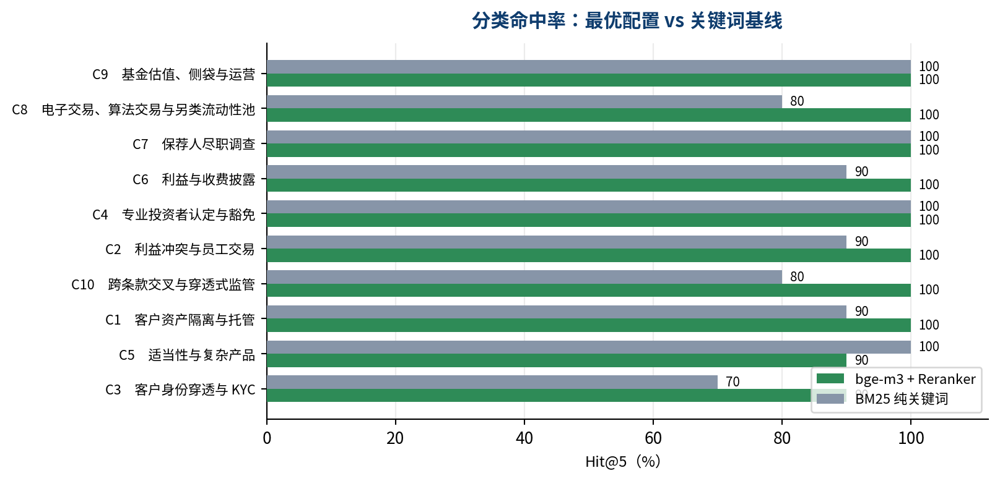

# 香港证监会监管文本检索基准

**HK Financial Regulatory RAG Benchmark — Technical Whitepaper**

**作者**　Angran Fei · AkuWezInbox@proton.me　｜　**评测对象**　香港证监会《持牌人操守准则》与《基金经理操守准则》全文条款级检索

!!! tip
本白皮书给出一套可复现的监管文本检索基准：**498 个条款级切块**（覆盖 236 个条款）、
**100 道金融合规评测问答**（含 21 道跨条款多 gold 题）、**6 个检索配置横向对比**。
全部指标在 1 vCPU / 3915 MB 内存的云主机上实测产出，
评测程序、语料切块与问答集均随附可逐条回溯至 PDF 原文页码。

## 一　业务背景与语料

### 1.1　为什么监管检索的幻觉容忍度为零

香港证监会的《操守准则》与《基金经理操守准则》不是参考读物，而是持牌法团的行为边界。
合规意见书、客户协议条款、专业投资者认定程序，其结论均须落到**具体条款编号**；
引错条款意味着向业务部门发出错误的行为授权，后果不是"答案不够好"，
而是法团在监管审查中无法为自身行为举证。

这与通用问答场景的差别在于**错误的不对称性**：漏检一条相关条款，
后果是合规人员多花时间继续查；错检一条不相关条款却被当作依据，
后果是在错误的法律基础上作出了业务决定。**后者的代价远高于前者**，
因此监管检索系统的首要指标不是"看起来相关"，而是**引用的条款编号是否就是那一条**。
本基准据此以条款级 Recall 与 NDCG 为核心指标，而非以答案文本的相似度为指标。

### 1.2　切块必须保持语义完整的真实后果

法规条款之间存在前置依赖，脱离依赖单独取用会得出相反结论。
本项目在标注评测集时即遭遇一例：

!!! warn
**豁免条款脱离前置程序的误读风险。**
《操守准则》15.4 与 15.5 列举了面向企业专业投资者与个人专业投资者**可豁免的条文清单**。
若检索系统单独返回 15.4，读者会得到「这些条文对专业投资者不适用」的结论。
但 15.4 的适用以 **15.2** 为前置：15.2(a) 要求在豁免生效前取得客户**书面签署的同意声明**、
**完整说明被视为专业投资者的后果**、并告知客户**有权随时撤回**；
15.2(b) 进一步要求**每年执行一次确认程序**。
**豁免不是无条件的，而是以一整套程序义务为对价。**
切块若将 15.2 与 15.4 割裂，检索结果在形式上正确、在合规上危险。

本项目的切块因此以**条款为最小单元**而非以固定字符数切分：
子项 `(a)(b)(i)` 一律归并至所属父条款，超长条款按段落边界分片且不截断句子，
并为每一块记录其在 PDF 中的**实际页码**，使任何一条检索结果都可回溯原文核验上下文。

### 1.3　语料来源

| 文档 | 版本 | 页数 | 条款单元 | 切块数 |
|---|---|---|---|---|
| **Code of Conduct for Persons Licensed by or Registered with the SFC** | 2019 年版 | 211 | 150 | 387 |
| **Fund Manager Code of Conduct** | 第三版 | 36 | 86 | 111 |

两份文档均自证监会官网直接取得，下载时校验 `%PDF` 魔数并记录 SHA-256，无人工转录环节：

| 文件 | 字节数 | SHA-256（前 16 位） |
|---|---|---|
| `sfc_code_of_conduct.pdf` | 2,418,947 | `7793706166c18bc6…` |
| `sfc_fund_manager_code.pdf` | 701,885 | `efdc2d5237da3bed…` |

切块后的正文长度中位数为 1002 字符，单块上限 1,400 字符（按段落边界切分，不截断句子）。

### 1.4　切块流程

<div class="arch">
<div class="row">
  <div class="nd"><b>① 原文抽取</b><span>pdftotext -layout<br>保留缩进层级</span></div>
  <div class="nd"><b>② 正文界定</b><span>显式排除封面、版权页<br>与目录页区间</span></div>
  <div class="nd"><b>③ 页脚剥离</b><span>整行页码、罗马数字<br>与 50b/50z 类混合页码</span></div>
</div>
<div class="ar">▼</div>
<div class="row">
  <div class="nd ok"><b>④ 条款识别</b><span>GP1–GP9 总则<br>顶格「编号 + 标题」<br>Schedule N 附表</span></div>
  <div class="nd ok"><b>⑤ 子项归并</b><span>(a)(b)(i) 子项<br>并入所属父条款</span></div>
  <div class="nd ok"><b>⑥ 超长分片</b><span>按段落边界切分<br>不截断句子</span></div>
</div>
<div class="band">⑦ 输出　chunk_id · doc_id · clause_id · clause_title · <b>PDF 页码</b> · 正文　→　每块均可回溯原文核验</div>
</div>
<p class="figcap"><b>图 1　条款级切块流程。</b>第 ② 步与第 ③ 步是语料纯净度的关键：目录页同样含有密集的条款编号，若不显式排除会被识别为正文条款。</p>

### 1.5　切块版本与数据纯净度

初版切块产出 760 块，经审计发现三项结构性缺陷，均会直接动摇评测有效性：

| 缺陷 | 表现 | 对评测的影响 |
|---|---|---|
| **目录页混入语料** | 20 个切块的正文形如「Application 39 / [16.2] Interpretation 39」 | 引入与条款高度相似但无实质内容的噪声文档 |
| **条款编号跨段继承** | 前言段落被标注为条款 20.1 | gold 标注失真，检索「命中」与否不可信 |
| **编号重复** | 266 个切块共用 97 个重复 clause_id | 条款级命中唯一性丧失，Recall 不可计算 |

重建后的 v2 语料为 498 块，chunk_id 全局唯一，目录污染为零，
抽样核验 `GP8 Client assets`（p17）、`11.1 Handling of client assets`（p45）、
`12.2 Employee dealings`（p46）、`Sch6 Leveraged foreign exchange trading`（p160）
的条款号、标题与页码与法规原文一致。**本基准的全部指标基于 v2 语料。**

## 二　评测集

### 2.1　题型分布

| 类别 | 场景 | 题数 | 高难度 | 跨条款多 gold | 代表 gold 条款 |
|---|---|---|---|---|---|
| C1 | 客户资产隔离与托管 | 10 | 2 | 2 | 11.1、3.6、3.7、4.1.2 |
| C2 | 利益冲突与员工交易 | 10 | 2 | 1 | 10.1、10.2、12.2、16.4 |
| C3 | 客户身份穿透与 KYC | 10 | 7 | 4 | 3.11.1、5.1、5.1A、5.3 |
| C4 | 专业投资者认定与豁免 | 10 | 8 | 2 | 15.1、15.2、15.4、15.5 |
| C5 | 适当性与复杂产品 | 10 | 3 | 1 | 3.10、3.4、5.2、5.3 |
| C6 | 利益与收费披露 | 10 | 3 | 1 | 2.2、2.3、3.11、7.2 |
| C7 | 保荐人尽职调查 | 10 | 8 | 0 | 17.10、17.11、17.12、17.13 |
| C8 | 电子交易、算法交易与另类流动性池 | 10 | 8 | 5 | 18.10、18.11、18.3、18.4 |
| C9 | 基金估值、侧袋与运营 | 10 | 4 | 1 | 5.1、5.2.1、5.2.2、5.3.1 |
| C10 | 跨条款交叉与穿透式监管 | 10 | 10 | 4 | 1.11、1.3、11.1、12.5 |

### 2.2　标注规则与校验

每题标注 `(doc_id, clause_id)` 形式的 gold 条款，跨条款题标注多个。构建脚本在输出前
逐一校验 gold 条款在语料中真实存在，任一不存在即终止并报错——
100 题全部通过该校验。难度标注中 55 题为高难度，
取自冷门条款（如 20.5 可比 OTC 衍生工具司法管辖区、12.7 专家证人）、
穿透式监管（5.4 指令发出人与实益拥有人）、客户资产隔离与利益冲突等合规实务高频痛点。

**标注错误的发现与修正。** 存在性校验只能确认 gold 条款存在，无法确认它是否真的回答了该问题。
为此另行计算每题「问题关键词」与「gold 条款正文」的覆盖度，对覆盖度最低的题目逐条回原文复核。
该流程查出三道题的标注指向错误条款：Q037、Q038、Q040 均被标注为 15.4（企业专业投资者豁免条款清单），
但其所问的**同意前披露、撤回权与年度确认程序**实际载于 **15.2**
（原文：`should carry out a confirmation exercise annually`、`has the right to withdraw from being treated as such at any time`）。
三题已更正为 15.2 并重新计分，本文全部指标基于更正后的标注。

!!! warn
**评测集由项目作者依据条款索引构建，非第三方公开基准。** 其价值在于标注可逐条回溯至
法规原文页码、gold 存在性经程序校验、低覆盖度题目经人工回原文复核，而非在于规模或权威性。
跨机构可比的结论需以公开基准复核。

### 2.3　代表性样题

| 题号 | 问题 | gold 条款 |
|---|---|---|
| Q005 | What due diligence must a Fund Manager carry out before appointing a custodian? | FMCC 4.2.1·p19、4.2.2·p20 |
| Q017 | May a Fund Manager permit relevant persons to deal ahead of client or fund orders? | FMCC 2.1.3·p10 |
| Q024 | What is required when characterising whether a client has knowledge of derivatives? | COC 5.1A·p25 |
| Q040 | How often must the Professional Investor assessment be reviewed? | COC 15.2·p56 |
| Q043 | What obligations apply specifically to complex products? | COC 5.5·p27 |
| Q052 | What transaction related information must be disclosed to clients? | COC 8.3A·p41 |
| Q063 | What is the scope of a sponsor's due diligence obligation? | COC 17.6·p80 |
| Q078 | Who may be given access to an alternative liquidity pool? | COC 19.4·p102 |
| Q085 | What must be done before a side pocket is introduced in a fund? | FMCC 5.4.1·p23 |
| Q097 | What must be notified to the Commission and in what circumstances? | COC 12.5·p48 |

每题的 gold 条款均标注其在 PDF 中的实际页码，审阅者可直接翻至该页核对问题与条款是否对应。

## 三　检索配置与关键决策

六个配置构成一个 **2×2 消融矩阵**（模型尺寸 × 是否融合 BM25）外加两个端点：
纯关键词基线 E，以及在全规格之上追加交叉编码重排的 B。
该设计使「模型尺寸」与「是否融合」两个变量可以分别归因，而非混在一起比较。

| 配置 | 检索方式 | 模型 | 在消融矩阵中的位置 |
|---|---|---|---|
| **E** | 纯关键词 | BM25（Okapi） | 对照基线 |
| **C** | 纯稠密 | bge-small-en-v1.5（384 维） | 小模型 × 不融合 |
| **D** | 稠密 + 关键词 RRF 融合 | bge-small + BM25 | 小模型 × 融合 |
| **A** | 纯稠密 | bge-m3（1024 维） | 大模型 × 不融合 |
| **F** | 稠密 + 关键词 RRF 融合 | bge-m3 + BM25 | 大模型 × 融合 |
| **B** | 稠密召回 + 交叉编码重排 | bge-m3 + bge-reranker-v2-m3 | 精度优先的生产上界 |

影响结论成立与否的决策记录于架构决策记录（ADR），全文附于第六节：
**ADR-001** 内存点积与内存 BM25 替代独立向量数据库、**ADR-003** 融合采用 RRF 而非加权相加、
**ADR-004** 以重排替代增大 top-k、**ADR-005** 评测集统一英文、
**ADR-006** 分阶段独立进程的评测架构、**ADR-007** 条款级而非切块级的命中判定。

## 四　实测结果

### 4.1　检索质量

| 配置 | 向量维度 | Recall@1 | Recall@5 | Hit@1 | Hit@5 | MRR@10 | NDCG@5 | 严格 Recall@5 |
|---|---|---|---|---|---|---|---|---|
| E　BM25 纯关键词 | — | 49.83 | 84.00 | 56 | 90 | 70.50 | 71.22 | 78.00 |
| C　bge-small 纯稠密 | 384 | 61.17 | 88.17 | 70 | 91 | 79.18 | 79.42 | 85.00 |
| D　bge-small + BM25 | 384 | **66.17** | 87.50 | 75 | 92 | 82.56 | 81.01 | 83.00 |
| A　bge-m3 纯稠密 | 1024 | 64.17 | 92.17 | 73 | 96 | 82.61 | 82.95 | 88.00 |
| F　bge-m3 + BM25 | 1024 | 57.67 | 90.00 | 66 | 96 | 78.23 | 78.55 | 84.00 |
| B　bge-m3 + Reranker | 1024 | 65.67 | **95.17** | 74 | 98 | **84.74** | **85.90** | **92.00** |

<div class="figwrap"></div>
<p class="figcap"><b>图 2　四项核心指标横向对比。</b>黑框标示该指标的最优配置。</p>

**关键词基线并不弱。** BM25 在 Recall@5 上达到 84.00%，原因是监管文本的条款标题与查询用语高度重合（如 “best execution”、“side pocket”、“due diligence”），术语本身即为强检索信号。任何声称稠密检索在法规场景大幅碾压关键词检索的结论，都应先核对基线是否被正确实现。

**全规格与轻量档的差距集中在首位命中。** bge-m3（1024 维）相对 bge-small-en-v1.5（384 维）在 Recall@1 上领先 3.00 个百分点，Recall@5 上领先 4.00 个百分点。维度提升主要改善排序质量而非召回覆盖面。

**多路融合不是万灵药，其收益取决于两路检索器的强弱是否匹配。** 这是本基准最具工程价值的一条结论，由 2×2 消融设计（模型尺寸 × 是否融合 BM25）直接给出：

| 融合组合 | 稠密侧单独 Recall@1 | 融合后 Recall@1 | 变化 |
|---|---|---|---|
| bge-small（384 维）+ BM25 | 61.17% | **66.17%** | **+5.00** |
| bge-m3（1024 维）+ BM25 | 64.17% | **57.67%** | **-6.50** |

同一个 BM25（单独 Recall@1 仅 49.83%），融入轻量档使首位命中**提升 5.00 个百分点**，融入全规格档却使其**下降 6.50 个百分点**。根因在于 RRF 只使用排名、不使用分数（见 ADR-003）：当稠密侧显著强于关键词侧时，等权融合让弱侧的错误结果获得与强侧同等的排名权重，把强侧原本正确的首位结果挤出第一名。**因此「上混合检索」不是一个可以无条件照搬的架构决策**——在采用等权 RRF 之前，必须先确认两路召回器的单独表现处于同一量级，否则融合是净损失。

**覆盖面与首位命中需分开决策。** 融合在 Recall@5 上的表现与 Recall@1 并不同向：轻量档融合后 Recall@5 为 87.50%（单独 88.17%），全规格档融合后为 90.00%（单独 92.17%）。融合提升双路共识条款的排名，代价是少数仅由稠密检索召回的 gold 条款被挤出前五。若下游只取 top-1 交付人工复核，应按 Recall@1 选型；若取 top-k 作为生成端的上下文窗口，应按 Recall@5 与严格 Recall@5 选型。

**重排的收益与代价均显著。** 交叉编码重排使 Recall@1 提升 1.50 个百分点，但单查询新增约 102.9 秒（CPU，候选池 top-20）。该延迟在 GPU 上可降低一个数量级，但在纯 CPU 部署下已超出交互式查询的可接受范围。

### 4.2　成本

| 配置 | 语料编码耗时 | 单查询 p50 | 单查询 p95 | 进程峰值内存 | 备注 |
|---|---|---|---|---|---|
| E　BM25 纯关键词 | — | 0.8 ms | 1.1 ms | 34 MB | — |
| C　bge-small 纯稠密 | 110 s | 31.6 ms | 42.4 ms | 784 MB | batch=16 |
| D　bge-small + BM25 | — | 32.4 ms | — | 784 MB | RRF k=60，两路各取 top-100 |
| A　bge-m3 纯稠密 | 1747 s | 446.7 ms | 5694.0 ms | 1,943 MB | batch=4 |
| F　bge-m3 + BM25 | — | 447.4 ms | — | 1,943 MB | RRF k=60，两路各取 top-100 |
| B　bge-m3 + Reranker | — | 103,392.7 ms | — | 2,267 MB | 重排候选池 top-20 |

<div class="figwrap"></div>
<p class="figcap"><b>图 3　延迟与内存开销。</b>左图为对数坐标。内存为进程峰值常驻集（RSS），含模型权重与向量索引。</p>

### 4.3　分类表现

| 类别 | 题目场景 | bge-m3 + Reranker Hit@5 | BM25 Hit@5 | 差值 |
|---|---|---|---|---|
| C1 | 客户资产隔离与托管 | **100** | 90 | +10 |
| C2 | 利益冲突与员工交易 | **100** | 90 | +10 |
| C3 | 客户身份穿透与 KYC | **90** | 70 | +20 |
| C4 | 专业投资者认定与豁免 | **100** | 100 | 0 |
| C5 | 适当性与复杂产品 | **90** | 100 | -10 |
| C6 | 利益与收费披露 | **100** | 90 | +10 |
| C7 | 保荐人尽职调查 | **100** | 100 | 0 |
| C8 | 电子交易、算法交易与另类流动性池 | **100** | 80 | +20 |
| C9 | 基金估值、侧袋与运营 | **100** | 100 | 0 |
| C10 | 跨条款交叉与穿透式监管 | **100** | 80 | +20 |

<div class="figwrap"></div>
<p class="figcap"><b>图 4　分类命中率对比。</b>按最优配置的 Hit@5 升序排列，与关键词基线并置。</p>

### 4.4　失败归因

**失败集定义**：四个基础配置（BM25 / bge-small / bge-small+BM25 / bge-m3）的 top-5 条款中均无任一 gold 条款。重排配置 B 是对 A 的 top-20 候选重排，A 的候选池若无 gold 条款，B 必然同样未命中，故以四个基础配置界定失败集不会遗漏。

按此定义，100 题中有 **0 题**（0.0%）被全部配置漏检。

**单配置独有贡献**：共 3 题仅被某一个配置在前五命中——BM25 纯关键词 1 题；bge-m3 纯稠密 2 题。这说明各配置的失败模式并不重合：稠密检索擅长语义改写，关键词检索擅长术语精确匹配，二者的召回集合存在互补空隙。

上述结果的直接含义是：**四个基础配置的并集覆盖率已接近全集**，因此在生产环境中，多路召回取并集再统一排序，其收益可能高于继续增大单一模型的参数量。

## 五　结论与选型建议

| 场景 | 推荐配置 | 依据 |
|---|---|---|
| **交互式查询**<br>（CPU 部署） | bge-small + BM25 | Recall@1 **66.17%**（全配置最高）、单查询 32 ms、内存 784 MB |
| **离线批量审阅**<br>（精度优先） | bge-m3 + Reranker | Recall@5 **95.17%**、NDCG@5 **85.90%**；单查询 103 s，非实时专用 |
| **边缘部署**<br>（无 GPU） | BM25 纯关键词 | Recall@5 84.00%、延迟 0.78 ms、内存 34 MB，零模型依赖 |

!!! tip
**本基准的三条可迁移结论。**
**①** 法规文本的条款标题承载了极强的检索信号，关键词基线必须作为对照项实现，
否则容易把「语料本身好检索」误读为「模型效果好」。
**②** 向量维度的提升主要兑现为排序质量（Recall@1、MRR）而非召回覆盖面（Recall@5），
选型应依据下游是取 top-1 还是 top-k 的上下文窗口而定。
**③** 交叉编码重排在 CPU 上的延迟代价是数量级的，其部署可行性由硬件而非效果决定。

!!! warn
**绝对 Recall 受真实标注的完备性限制，本文的结论建立在横向对比之上。**
复核发现，最优配置在 26 道题上的首位检出条款落在 gold 清单之外，
其中约四分之一属于**标注不完整而非检索错误**——例如「将企业客户视为专业投资者前须完成何种评估」
一题检出 15.2，而 gold 标注为 15.4，但前置评估程序恰恰载于 15.2，该检出结果同样成立。
因此**本文的绝对 Recall 数值应被理解为下界，不应作为「准确率」对外引用**。
由于六档配置使用同一套 gold 标注接受评分，
**配置之间的横向对比规律不受标注完备性影响**，本文的全部结论均建立在该对比之上。

**其余已知边界**：① 评测集为自建，非第三方公开基准（见 2.2 节）；
② 全部查询为英文，未覆盖中文及中英混合查询场景（见 ADR-005）；
③ 指标为检索质量，未评估生成端的忠实度与引用正确性，该环节需另行以答案级标注评测；
④ 延迟与内存在 1 vCPU 云主机上测得，不代表 GPU 或多核环境下的表现。
!!!

## 六　复现与架构决策记录

### 6.1　复现步骤

```bash
pip install -r requirements.txt    # 依赖；PyTorch 建议装 CPU 版以免拉入 CUDA
./run_eval.sh                      # 单一入口：切块 → 六档评测 → 图表 → 正文 → PDF → 质检
```

该脚本串联的完整阶段为：

```
corpus/fetch.py        取原文 PDF，校验 %PDF 魔数与 SHA-256
src/chunk2.py          条款级切块                 → data/chunks_v2.jsonl
data/build_eval_set.py 评测集 + gold 存在性校验   → data/eval_set_100.json
data/audit_eval_set.py 标注体检：覆盖度排序，低覆盖题回原文复核
src/eval_rag_cpu.py    bm25 → small → hybrid → m3 → hybridm3 → rerank → merge
                       （每阶段独立进程，排名矩阵落盘，见 ADR-006）
src/analyze_failures.py  失败归因                → results/failure_analysis.json
src/make_figs.py / gen_whitepaper.py / build_pdf.py / verify_whitepaper.py
```

模型权重置于 `./models/` 或以环境变量 `MODEL_DIR` 指向，代码内无绝对路径。
标注修正后执行 `./run_eval.sh rescore`：该模式复用已落盘的排名矩阵重算全部指标，
无需重新编码语料（可省去 bge-m3 约 29 分钟的编码开销）。

执行环境：1 vCPU ／ 3915 MB 物理内存 ／
4095 MB Swap ／ PyTorch 2.14.1+cpu（CPU）／ Python 3.11.2。
模型权重为 BAAI 官方发布的 `bge-small-en-v1.5`、`bge-m3`、`bge-reranker-v2-m3`。

### 6.2　架构决策记录

#### ADR-001　在轻量监管法规场景下采用 NumPy 内存点积与内存 BM25，替代独立向量数据库

**背景**　语料为两部香港证监会法规，切块后共 498 个条款级单元。 全规格配置下向量规模为 498 × 1024 维 float32，约 **2.0 MB**； 轻量档 498 × 384 维约 **0.75 MB**。关键词检索侧的倒排索引量级与之相当。 项目早期曾规划以 pgvector 承载向量检索、以 Postgres `tsvector` 承载全文检索。

**决策**　向量检索以 **NumPy 内存点积**实现（向量 L2 归一化后，相似度即单次矩阵乘）； 关键词检索以 **内存 BM25（rank_bm25 Okapi）** 实现。 不引入 pgvector、Elasticsearch 或任何托管向量服务。

**理由**　**① 规模决定架构。** 2 MB 量级的向量全部驻留内存，单次全量点积在 1 vCPU 上耗时低于毫秒级； 近似最近邻索引（HNSW/IVF）的存在意义是在百万级向量上以召回率换延迟， 在 498 条上它只会引入召回损失而没有任何延迟收益。 **② 延迟构成的真实分布。** 实测单查询 p50 延迟中， 轻量档 31.57 ms、全规格档 446.66 ms，其中绝大部分是**查询文本的编码耗时**， 检索本身（点积 + 排序）不构成瓶颈。引入外部向量库无法改善主要矛盾， 反而新增一次网络往返。 **③ 冷启动与零运维。** 内存方案无需建库、无需迁移、无需维护连接池与扩展版本， 进程启动即可用；评测的分阶段独立进程架构（ADR-006）也要求各阶段能独立冷启动， 外部有状态依赖会与该设计冲突。 **④ 部署复杂度与可审计性。** 整条检索链仅依赖 Python 标准库、NumPy 与 rank_bm25， 可在内网离线环境完整复现；审计方无需理解数据库 schema 即可核对检索逻辑。 对金融机构而言，可审计性本身即为交付要求。

**后果**　本方案的适用边界明确：**语料规模增长至十万级切块时，内存点积的线性扫描将成为瓶颈**， 届时应切换至带 ANN 索引的向量库，并重新评估召回率损失。 本基准不提供该规模下的实测数据。 另需注意：内存方案不具备跨进程共享索引的能力， 多副本部署时每个副本需各自持有一份向量，内存占用随副本数线性增长。


#### ADR-003　多路融合采用 RRF 而非加权分数相加

**背景**　稠密检索输出余弦相似度（有界 0–1），BM25 输出无上界的 ts_rank 类分值， 两者量纲不可直接相加。

**决策**　采用倒数排名融合（Reciprocal Rank Fusion）：`score = Σ 1 / (k + rank_i)`，k = 60， 两路各取 top-100 参与融合。

**理由**　加权分数相加必须先归一化，而归一化系数本身是一个需要调优的超参， 且对查询分布敏感——在一套 100 题的评测集上调出的系数不具备可迁移性。 RRF 只使用**排名**不使用**分数**，天然免疫量纲问题，且无需调参。

**后果**　**RRF 丢弃分数强度信息，这一代价在本基准中被实测量化。** 两路检索器强弱匹配时融合有增益，不匹配时融合有损害： | 融合组合 | 稠密侧单独 Recall@1 | 融合后 Recall@1 | 变化 | |---|---|---|---| | bge-small (384 维) + BM25 | 61.17% | **66.17%** | **+5.00** | | bge-m3 (1024 维) + BM25 | 64.17% | **57.67%** | **−6.50** | BM25 单独的 Recall@1 为 49.83%。当稠密侧显著强于关键词侧时， 等权 RRF 使弱侧的错误结果获得与强侧同等的排名权重， 将强侧原本正确的首位结果挤出第一名。 **因此 RRF 的等权假设是一项前提条件，而非普适最优**； 若需在强弱悬殊的两路间融合，应改用带可学习权重的融合或级联式召回。


#### ADR-004　以交叉编码重排替代单纯增大 top-k

**背景**　提升召回覆盖面有两条路径：直接增大返回条数 k，或在粗排之上追加精排。

**决策**　保持下游上下文窗口为 top-5，在其之上以 bge-reranker-v2-m3 对稠密召回的 top-20 候选池做交叉编码重排。

**理由**　单纯增大 k 的三项代价：① 挤占下游大模型的上下文预算； ② 引入低相关片段，反而降低生成答案的忠实度；③ 延迟随 k 线性增长。 重排以一次小模型推理换取排序质量，使下游在同样的 5 条预算内获得更高相关度。

**后果**　**收益与代价均已实测量化。** 相对 bge-m3 纯稠密： | 指标 | 纯稠密 | + 重排 | 变化 | |---|---|---|---| | Recall@1 | 64.17% | 65.67% | +1.50 | | Recall@5 | 92.17% | **95.17%** | +3.00 | | NDCG@5 | 82.95% | **85.90%** | +2.95 | | 严格 Recall@5 | 88.00% | **92.00%** | +4.00 | | 单查询 p50 延迟 | 446.66 ms | **103,392 ms** | ×231 | 在 1 vCPU 环境下重排使单查询延迟升至约 103 秒， **其部署可行性由硬件而非效果决定**：该配置适用于离线批量审阅， 不适用于交互式查询。GPU 环境下该延迟可降低约一个数量级， 但本基准未在 GPU 上实测，不提供该数值。


#### ADR-005　评测集统一使用英文

**背景**　语料为香港证监会英文法规原文（《持牌人操守准则》《基金经理操守准则》）。 评测需对比多语种模型 bge-m3 与英文单语模型 bge-small-en-v1.5。

**决策**　100 题评测集全部以英文撰写。

**理由**　bge-small-en-v1.5 为英文单语模型。若以中文出题，该档成绩将因语种不匹配而系统性偏低， 得到的差距无法区分「模型容量差异」与「语种覆盖差异」，使双模对比结论不成立。 统一英文可将变量收敛为检索能力本身。香港持牌法团合规人员查阅 SFC 条文亦以英文为主， 英文查询符合真实使用场景。

**后果**　本基准不反映跨语种检索能力。中文查询场景下 bge-m3 的多语种优势未被测量， 如需评估应另建中英对照评测集，并作为独立实验报告。


#### ADR-006　分阶段独立进程的评测架构

**背景**　评测执行环境为 1 vCPU、约 1.5 GB 可用物理内存、3.6 GB Swap 的云主机。 bge-m3 与 bge-reranker-v2-m3 的 fp32 权重各约 2.2 GB。

**决策**　评测拆分为 bm25 / small / hybrid / m3 / rerank / merge 六个阶段， 每阶段为独立进程，中间排名以 `.npy` 落盘，最终由 merge 阶段汇总。

**理由**　单进程内连续加载两个 2.2 GB 模型将超出可用内存，触发 OOM。 Python 进程内 `del` 与 `gc.collect()` 不保证将内存归还操作系统， 只有进程退出才能完整释放。分阶段架构同时带来两项工程收益： 任一阶段失败可单独重跑而不必重算全部；各阶段峰值内存可独立测量并归因。

**后果**　阶段间需通过磁盘交换中间结果，引入少量 I/O 开销（排名矩阵为 100×200 int32，可忽略）。 `hybrid` 与 `rerank` 阶段依赖前序阶段的落盘产物，执行顺序不可调换。


#### ADR-007　条款级而非切块级的命中判定

**背景**　一个法规条款（如 Schedule 4、17.6 Due diligence）因篇幅较长会被切分为多个切块。 评测集的 gold 标注为条款编号，而非具体切块。

**决策**　检索结果先由切块排名折叠为条款排名（同一 clause_id 取其最佳名次，去重保序）， 再计算 Recall@k / Hit@k / MRR / NDCG。

**理由**　若按切块判定，同一条款的多个切块会重复占据排名前列， 使 Recall@5 虚高且无法反映「是否找到了正确条款」这一真实业务目标。 合规人员的诉求是定位到条款，而非定位到某个切块。

**后果**　切块粒度的差异（长条款切得更碎）不再直接影响指标， 各配置在同一折叠规则下可比。副作用是无法评估切块内部的定位精度， 该维度需另行以答案片段级标注评测。


---

**Angran Fei** · AkuWezInbox@proton.me　｜　*语料切块、评测集、评测程序与本文全部指标可复现；每个切块均标注 PDF 页码以供回溯原文。*
